<div align="center">


<br/>

**AI & Data Science Intern @ RBIH &nbsp;·&nbsp; Graph Memory Researcher &nbsp;·&nbsp; FalkorDB Featured &nbsp;·&nbsp; 7× Scopus Author**

<br/>

[](https://linkedin.com/in/tharun-kumar-developer)
[](https://tharun-kumar.vercel.app)
[](https://www.falkordb.com/blog/ai-agent-memory-graph-patterns/)
[](mailto:tharunkumar10032006@gmail.com)

</div>

<br/>

## What I build

I build AI systems that **explain themselves** — not just systems that work, but systems where you can trace exactly why they reached a conclusion.

At **RBIH** (Reserve Bank of India's innovation arm), I work on **MuleHunter.AI**, a real-time financial fraud detection system operating across India's banking infrastructure. The work has to be right: it protects real people's money.

Outside RBIH, I build to prove ideas.

<br/>

## 🏆 Highlights

<div align="center">

| | Achievement | Detail |
|:--:|:--|:--|
| 🔷 | **FalkorDB Featured** | Relay selected as **Pattern #2** from **647 teams globally** · CEO said *"Absolutely"* |
| 🥈 | **Amazon ML Challenge 2026** | **Top 50 / 32,000+** teams · reached **2nd** on the leaderboard mid-competition |
| 📊 | **STATATHON 2025-26** | **Runner-Up** · top **0.5% of 5,300 teams** · Ministry of Statistics, India |
| 💡 | **IEEE Tech4Good** | **$3,300 funded** · vertical farming via aeroponics · patent granted |
| 🏅 | **IET Innovation Challenge** | Mobile App Development **Winner** |
| 📝 | **Research** | **7 Scopus-indexed publications** · 8 citations · 1 patent |

</div>



## 🔷 Featured: Relay — Shared Graph Memory for AI Agents

<table>
<tr>
<td width="58%" valign="top">

> *Featured by FalkorDB as one of 5 patterns from 647 projects*

Three AI agents that **never message each other**, coordinated entirely through one **FalkorDB knowledge graph**.

Facts are stored with **bi-temporal clocks**: old facts are closed, not deleted, so you can ask what the system believed on any past day.

**Stack:** FalkorDB · FastAPI · React + TypeScript · Groq · Gemini · Cypher · MCP

</td>
<td width="42%" valign="middle" align="center">

### 99.4%
accuracy vs **61.3%** vector baseline

**McNemar p = 1.4 × 10⁻¹⁷**
<sub>160 questions · 40 simulated customers</sub>

</td>
</tr>
</table>

<div align="center">

[](https://wifight.vercel.app)
[](https://www.falkordb.com/blog/ai-agent-memory-graph-patterns/)
[](https://github.com/tharunkumardeveloper/The-Final-Boss)

</div>



## 🧠 Projects

| Project | What it does | Stack |
|:--|:--|:--|
| **[Relay / WiFight](https://github.com/tharunkumardeveloper/The-Final-Boss)** | Shared graph memory for AI agent teams | `FalkorDB` `FastAPI` `React` |
| **[NeuroVision](https://github.com/tharunkumardeveloper/Neurovision)** | Explainable Alzheimer's detection (SHAP + attention) | `Python` `PyTorch` `SHAP` |
| **[TalentTrack](https://github.com/tharunkumardeveloper/Talent-Track-cyber)** | AI sports talent assessment platform | `TypeScript` `OpenCV` `MediaPipe` |
| **[Indicraft](https://github.com/tharunkumardeveloper/indicraft-global-crafts-36)** | Artisan marketplace · 60% income increase across 10+ countries | `TypeScript` `LLMs` |
| **[INSIGHT IQ](https://github.com/tharunkumardeveloper/INSIGHT-IQ-MODULE-4)** | Real-time market and financial intelligence platform | `Python` `RAG` |

<br/>

## 🛠 Stack

<div align="center">


</div>

```
Graph AI      →  FalkorDB · Neo4j · Cypher · GraphRAG · Knowledge Graphs
LLMs & Agents →  Groq · Gemini · OpenAI · MCP · RAG · Prompt Engineering
ML / MLOps    →  Drift Detection · Model Monitoring · Inference Benchmarking
Languages     →  Python · TypeScript · SQL · Cypher
Frameworks    →  FastAPI · React · Pydantic · OpenCV · MediaPipe
Research      →  Quantum ML · Scopus · Statistical Testing (McNemar)
```



## 📄 Selected Publications <sub>*(Scopus-indexed)*</sub>

1. Optimizing Quantum SVM Using Hybrid Quantum Natural Gradient Descent and Butterfly Optimization Algorithm
2. Optimizing Quantum K-Nearest Neighbours Using Hybrid Gradient Descent and Golden Eagle Optimization Algorithm
3. Hybrid K-Means and Firefly Algorithm for Healthcare Data Clustering
4. Optimizing QSVM Circuits Using QNGD & WOA

<sub>+ 3 more publications in AI and financial systems</sub>

<br/>

## 📬 Reach me

<div align="center">

**Open to Applied Scientist / ML Engineer roles and graph AI research collaborations.**

📧 [tharunkumar10032006@gmail.com](mailto:tharunkumar10032006@gmail.com) &nbsp;·&nbsp; 💼 [LinkedIn](https://linkedin.com/in/tharun-kumar-developer) &nbsp;·&nbsp; 🌐 [Portfolio](https://tharun-kumar.vercel.app)

<br/>


</div>
