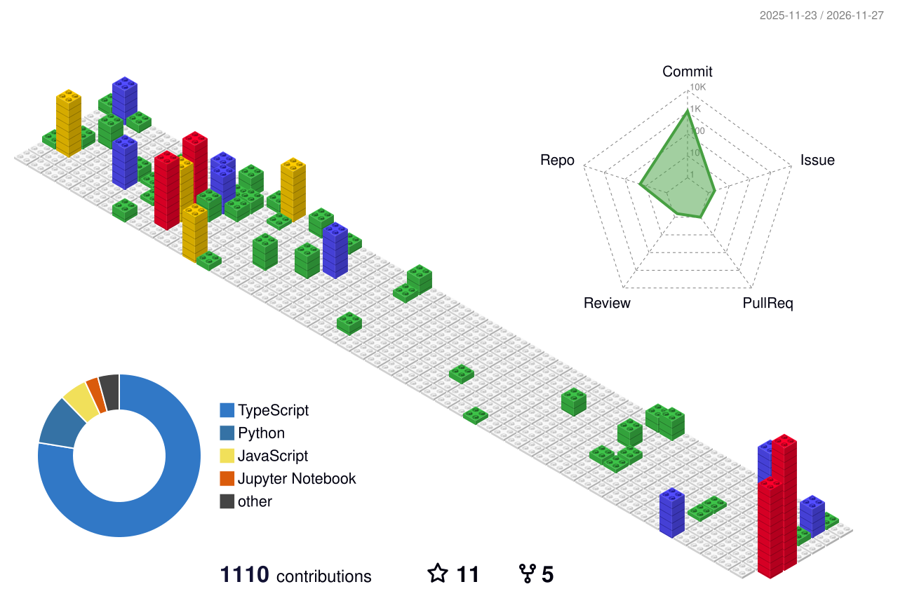

<div align="center">

<!--═══════════════════════════════════════════════════════════════
                           HEADER
═══════════════════════════════════════════════════════════════-->




</div>

<br/>

<!--═══════════════════════════════════════════════════════════════
                        SOCIAL LINKS
═══════════════════════════════════════════════════════════════-->

<div align="center">

[](https://linkedin.com/in/tharun-kumar-developer)&nbsp;
[](https://tharun-kumar.vercel.app)&nbsp;
[](https://github.com/tharunkumardeveloper)&nbsp;


</div>

<br/>

<!--═══════════════════════════════════════════════════════════════
                         ABOUT ME
═══════════════════════════════════════════════════════════════-->

<table align="center" border="0" width="96%" cellpadding="16" cellspacing="0">
<tr>
<td width="22%" align="center" valign="middle">


<br/><br/>

**Tharun Kumar C**<br/>
<sub>AI Researcher &middot; Developer &middot; Author</sub>

<br/>


</td>
<td width="78%" valign="middle">

## About Me

> *"Bridging cutting-edge AI research with real-world impact — one commit at a time."*

I'm **Tharun Kumar C** — an **AI Researcher**, **Patent Holder**, **6x Published Author**, and **Pre-final Year CS Student** at Sri Sairam Engineering College. I build intelligent systems from clinical AI to full-stack platforms, with deep focus on **LLMs**, **Explainable AI**, and **Agentic Automation**.

```python
tharun = {
    "role":       ["AI Researcher", "Full-Stack Developer", "6x Author"],
    "highlights": ["Patent Holder", "RBIH NFPC Finalist", "STATATHON Finalist"],
    "experience": ["Ex-Data Science Intern @ RBIH", "Ex-Intern @ Infosys", "Ex-Intern @ 1M1B"],
    "interests":  ["LLMs", "Agentic AI", "XAI", "FinTech AI", "Healthcare AI"],
    "building":   "Jarvis — LLM-powered Personal AI Assistant",
    "status":     "Always open to collaborate",
}
```

</td>
</tr>
</table>

<!--═══════════════════════════════════════════════════════════════
             PAC-MAN DIVIDER — BELOW ABOUT ME
═══════════════════════════════════════════════════════════════-->

<div align="center">

</div>

<br/>

<!--═══════════════════════════════════════════════════════════════
             THARUN ASCII — BOLD BLOCK STYLE
═══════════════════════════════════════════════════════════════-->

<div align="center">

```
████████╗██╗  ██╗ █████╗ ██████╗ ██╗   ██╗███╗   ██╗
╚══██╔══╝██║  ██║██╔══██╗██╔══██╗██║   ██║████╗  ██║
   ██║   ███████║███████║██████╔╝██║   ██║██╔██╗ ██║
   ██║   ██╔══██║██╔══██║██╔══██╗██║   ██║██║╚██╗██║
   ██║   ██║  ██║██║  ██║██║  ██║╚██████╔╝██║ ╚████║
   ╚═╝   ╚═╝  ╚═╝╚═╝  ╚═╝╚═╝  ╚═╝ ╚═════╝ ╚═╝  ╚═══╝
```

</div>

<br/>

<!--═══════════════════════════════════════════════════════════════
              ACHIEVEMENTS — BOSS BATTLES WON
═══════════════════════════════════════════════════════════════-->

## Achievements & Highlights

### Boss Battles — Competitions

| Medal | Event | Venue | Result | Project |
|:---:|:---|:---|:---:|:---|
| 🏆 | **RBIH NFPC** (Reserve Bank Innovation Hub x IIT Delhi) | National | Top 12 / 87 Teams | ScamShield |
| 🥇 | **Mine Your Ideas** — Idea Pitching | Loyola-ICAM College | Winner | RATSAFE |
| 🥇 | **Business Pitch Competition** | Gojan School of Business | 1st Place | InSight IQ |
| 🥇 | **App Development Competition** (IET) | KCG College of Technology | 1st Place | TalentTrack |
| 🥇 | **AIRO 3.0** — Web Development | Sri Sairam Engineering College | 1st Place | Sportify |
| 🥇 | **TechXelerate** — Orator Quest | Sri Sairam Engineering College | Winner | Oratorical |
| 🥈 | **Amrita Hackathon Finals** | Amrita University | 8th / 31 Teams | ChainVoice |
| 🥈 | **Steganos'25** — Idea Pitching | SRM Easwari Engineering College | 2nd Place | Talent Track |
| 🥈 | **UNSCRIPTED'25** — Paper Presentation | St. Joseph Institute of Technology | Runner Up | Indicraft |
| 🏅 | **Xplore'25** | Loyola-ICAM | 2nd Place | Robotic arm (RATSAFE) |
| 🥉 | **FIKRA** — Business Pitch | Sri Sairam Engineering College | 3rd Place | INDICRAFT |
| 🌟 | **Orion Hackathon** | Madras Medical College | Special Mention | NeuroVision CDSS |
| 🚀 | **India AI Impact Buildathon** (HCL GUVI) | National | Qualified | Honeypot Tester |
| 🌐 | **STATATHON 2025** | National | Finalist | Statistical Modeling |

<br/>

### Research & Publications — Skill Unlocks

- **6x Published Author** — Scopus-indexed IEEE conference proceedings
- **Patent Published** — Aeroponics-based Vertical Farming System *(IEEE SIGHT funded)*
- **NeuroVision CDSS** — Multi-modal Alzheimer's detection *(CNN · RF · SVM · GBM + SHAP + Grad-CAM)*
- **ScamShield** — Fraud lifecycle modeling · 400M+ transactions · Transaction graph analysis
- **IEEE TEMS Volunteer Excellence Award** — Awarded for outstanding digital leadership as Webmaster

<br/>

### Experience — Side Quests Completed

| Company | Role | Year | Details |
|:---|:---|:---:|:---|
| **RBIH** (Reserve Bank Innovation Hub) | Data Science Intern | 2026 | AI & Data Science team · fraud detection and ML systems |
| **Infosys Springboard** | AI Intern | 2025 | Built INSIGHT-IQ — 7-API market intelligence platform |
| **WordPress & SEO Internship** | WordPress & SEO Intern | 2025 | Site optimization · metadata config · SEO improvements |
| **1M1B** (UN-accredited) | Intern | 2024–25 | Global impact initiatives |
| **Rudhra Info Solutions** | Web Developer | 2024 | FoodHopper platform |

<!--═══════════════════════════════════════════════════════════════
        SONIC + MARIO SIDE BY SIDE — BELOW ACHIEVEMENTS
═══════════════════════════════════════════════════════════════-->

<br/>

<table align="center" border="0" cellpadding="0" cellspacing="0">
<tr>
<td align="center"></td>
<td align="center"></td>
</tr>
</table>

<br/>

<!--═══════════════════════════════════════════════════════════════
                 TECH STACK — POWER-UPS EQUIPPED
═══════════════════════════════════════════════════════════════-->

## Tech Stack — Power-Ups Equipped

<div align="center">

<table border="0" width="96%" cellpadding="18" cellspacing="0">
<tr>
<td width="25%" align="center" valign="top">

**Languages**


</td>
<td width="25%" align="center" valign="top">

**Frontend**


</td>
<td width="25%" align="center" valign="top">

**Backend & DB**


</td>
<td width="25%" align="center" valign="top">

**Tools & DevOps**


</td>
</tr>
<tr>
<td colspan="4" align="center" valign="middle">

**AI / ML Ecosystem**


</td>
</tr>
</table>

</div>

<!--═══════════════════════════════════════════════════════════════
        FIGHTING GAME DIVIDER — FULL WIDTH, BELOW TECH STACK
═══════════════════════════════════════════════════════════════-->

<br/>

<div align="center">

</div>

<br/>

<!--═══════════════════════════════════════════════════════════════
                  FEATURED PROJECTS — MAIN QUESTS
═══════════════════════════════════════════════════════════════-->

## Featured Projects — Main Quests

<table align="center" width="96%" border="0" cellpadding="16" cellspacing="0">
<tr>
<td width="50%" valign="top">

### Relay
> *QUEST: Give AI agents a shared memory*

**Agent memory and coordination** on a FalkorDB knowledge graph, built for Graph Hacks (WeMakeDevs × FalkorDB), Track 02. **Featured on FalkorDB's blog** among standout agent-memory projects.


<a href="https://github.com/tharunkumardeveloper/The-Final-Boss"></a>

</td>
<td width="50%" valign="top">

### TalentTrack
> *QUEST: AI-powered fitness & talent analysis*

**AI fitness analysis platform** — won 1st Place at KCG App Dev Competition (IET) and presented at Steganos'25. Evaluates talent and performance through intelligent tracking.


- AI-driven talent and fitness assessment
- Mobile-first design with modern UI/UX
- Real-time performance analytics

<a href="https://github.com/tharunkumardeveloper/Talent-Track-Updated"></a>

</td>
</tr>
<tr>
<td width="50%" valign="top">

### ScamShield
> *QUEST: Hunt 400M+ fraudulent transactions*

**AI fraud detection pipeline** for the RBIH National Fraud Prevention Challenge — Top 12 of 87 teams nationally. Detects money mule accounts in banking transactions.


- Fraud lifecycle state machine + transaction graph analysis
- AUC 0.98 · F1 0.93 · 400M+ transactions processed
- Temporal pattern detection for mule account behavior

<a href="https://github.com/tharunkumardeveloper/Scamshield"></a>

</td>
<td width="50%" valign="top">

### Indicraft
> *QUEST: Take Indian crafts global*

**Platform connecting Indian artisan crafts with a global audience.** Runner Up at UNSCRIPTED'25 and 3rd Place at FIKRA Business Pitch.


<a href="https://github.com/tharunkumardeveloper/indicraft-global-crafts-36"></a>

</td>
</tr>
<tr>
<td width="50%" valign="top">

### INSIGHT-IQ
> *QUEST: Decode the market in real-time*

**AI-powered strategic intelligence platform** built during Infosys internship. Monitors competitors, detects market trends, and sends real-time alerts. Won 1st Place at Gojan Business Pitch Competition.


- 7 live APIs · NLP sentiment analysis · Prophet forecasting
- Slack webhook alerts · 10 technology domains

<a href="https://github.com/tharunkumardeveloper/INSIGHT-IQ-MODULE-4"></a>

</td>
<td width="50%" valign="top">

### NeuroVision CDSS
> *QUEST: Defeat Alzheimer's with AI*

**AI-Powered Clinical Decision Support** for early Alzheimer's detection via multi-modal biomarker integration. Special Mention at Orion Hackathon @ MMC.


- Ensemble ML: Random Forest · CNN · SVM · Gradient Boosting
- SHAP + Grad-CAM for Explainable AI
- Multi-stage: MMSE/CDR → Biomarkers → MRI

<a href="https://github.com/tharunkumardeveloper/Neurovision"></a>

</td>
</tr>
<tr>
<td colspan="2" valign="top">

### AeroGrowthSquad — Vertical Farming & Plant Health System
> *QUEST: Grow food without soil · Diagnose crops with AI*

**Aeroponics-based vertical farming system** combined with an **AI-powered plant health monitor** — the subject of a published patent funded by IEEE SIGHT. Detects pest and crop diseases via leaf image uploads across Tomato, Strawberry, and Corn.


- Aeroponic soil-free vertical farming — IEEE SIGHT funded
- CNN classifier for real-time leaf disease detection with confidence scores
- Multi-crop support: Tomato · Strawberry · Corn

<a href="https://github.com/tharunkumardeveloper/aerogrowthsquad"></a>

</td>
</tr>
</table>

<!--═══════════════════════════════════════════════════════════════
        PIXEL RETRO DIVIDER — BELOW PROJECTS
═══════════════════════════════════════════════════════════════-->

<br/>

<div align="center">

</div>

<br/>

<!--═══════════════════════════════════════════════════════════════
                  PUBLICATIONS — RESEARCH LOG
═══════════════════════════════════════════════════════════════-->

## Publications — Research Log

<div align="center">

| Year | Title | Venue |
|:---:|:---|:---:|
| 2025 | **Optimizing the Quantum Circuit of Quantum SVM Using Hybrid Quantum Natural Gradient Descent and Quantum Butterfly Optimization Algorithm** | Scopus · IEEE |
| 2025 | **Optimizing the Quantum Circuit of Quantum K-Nearest Neighbors Using Hybrid Gradient Descent and Golden Eagle Optimization Algorithm** | Scopus · IEEE |
| 2025 | **Optimizing Quantum Support Vector Machine Circuits Using Hybrid Quantum Natural Gradient Descent and Whale Optimization Algorithm** | Scopus · IEEE |
| 2025 | **Hybrid Gradient Descent and Sea Lion Optimization Algorithm to Optimize Task Scheduling in Fog Computing Environment** | Scopus · IEEE |

</div>

> All papers explore hybrid quantum/classical ML optimization — combining gradient-based methods with bio-inspired algorithms across quantum ML and distributed computing domains.

<!--═══════════════════════════════════════════════════════════════
        PAC-MAN STRIP DIVIDER — BELOW PUBLICATIONS
═══════════════════════════════════════════════════════════════-->

<br/>

<div align="center">

</div>

<br/>

<!--═══════════════════════════════════════════════════════════════
              CERTIFICATIONS — POWER-UP COLLECTION
═══════════════════════════════════════════════════════════════-->

## Certifications — Power-Up Collection

<div align="center">

| Certification | Issuer | Year | Skills |
|:---|:---|:---:|:---|
| Deep Learning for Developers | Infosys Springboard | 2025 | Deep Learning · Neural Networks · AI/ML |
| What is Metaverse | Meta | 2026 | Metaverse · VR · Digital Innovation |
| Go for Gold — Gold Level Achievement | Accenture iAspire | 2025 | Problem Solving · Technical Excellence |
| Deloitte Australia — Data Analytics Simulation | Deloitte | 2026 | Data Analytics · Business Intelligence |
| Career Essentials in Generative AI | Microsoft & LinkedIn | 2023 | Generative AI · Prompt Engineering |
| Cloud Computing | NPTEL | 2024 | Cloud · Distributed Systems |
| Foundations of Digital Marketing & E-commerce | Google / Coursera | 2024 | Digital Marketing · E-commerce |
| WordPress with Docker | Great Learning | 2024 | WordPress · Docker · DevOps |
| Agile Requirements Foundations | LinkedIn | 2023 | Agile · Requirements Engineering |
| Collaborating with G Suite Apps | Coursera | 2023 | G Suite · Productivity |

</div>

<br/>

<!--═══════════════════════════════════════════════════════════════
                     CONTRIBUTION GRAPH
═══════════════════════════════════════════════════════════════-->

## Contribution Graph — Activity Log

<div align="center">





</div>

<br/>

<!--═══════════════════════════════════════════════════════════════
                          FOOTER
═══════════════════════════════════════════════════════════════-->

<div align="center">



<picture>
  <source media="(prefers-color-scheme: dark)" srcset="https://raw.githubusercontent.com/tharunkumardeveloper/tharunkumardeveloper/output/github-snake-dark.svg" />
  
</picture>


<br/>

**[LinkedIn](https://linkedin.com/in/tharun-kumar-developer) &nbsp;·&nbsp; [Portfolio](https://tharun-kumar.vercel.app) &nbsp;·&nbsp; [GitHub](https://github.com/tharunkumardeveloper)**

</div>
